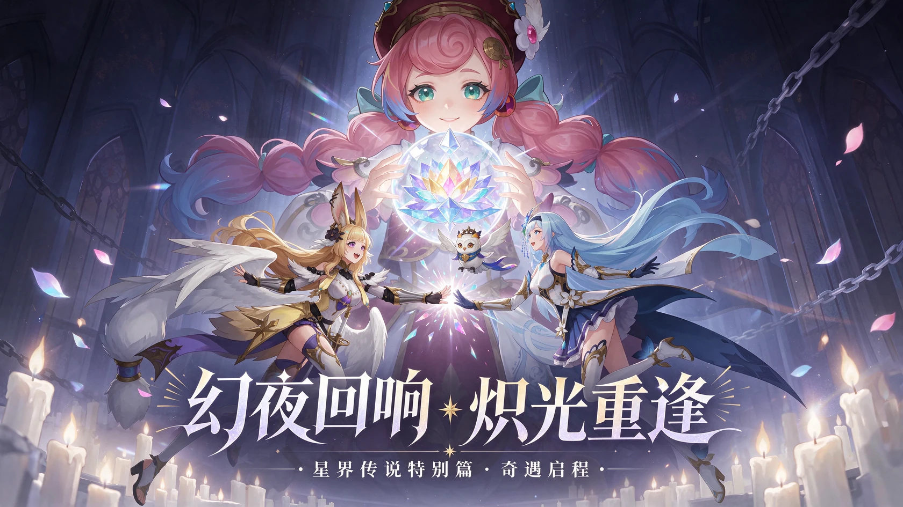
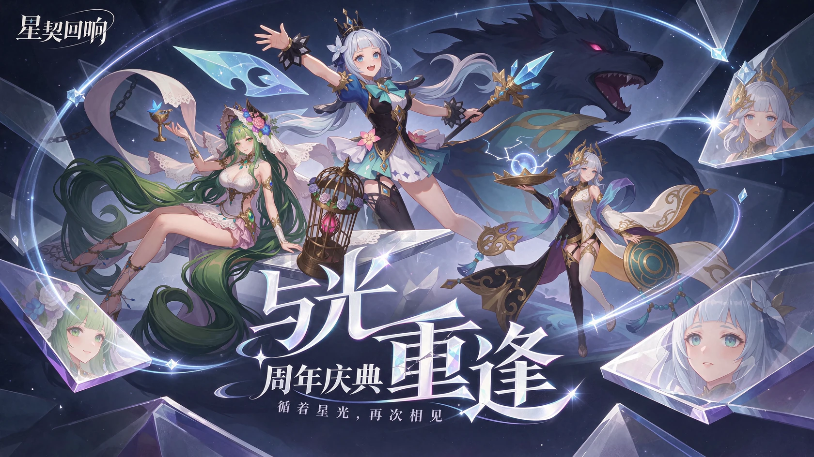
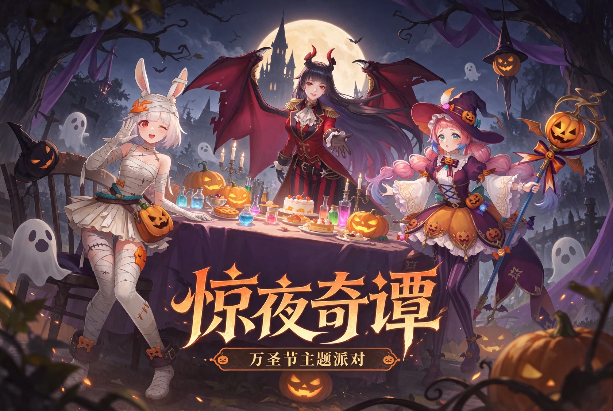
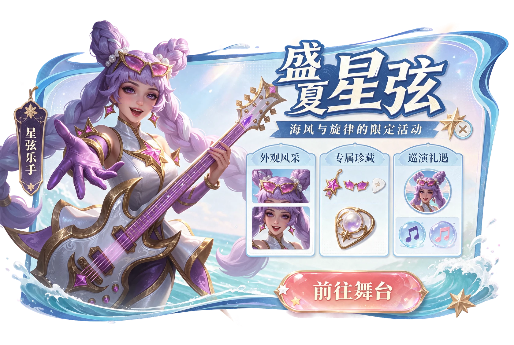
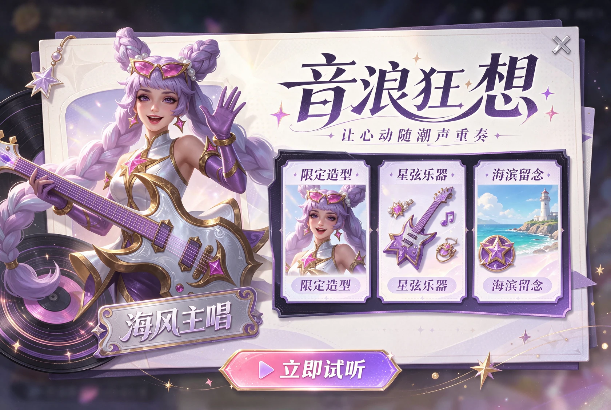
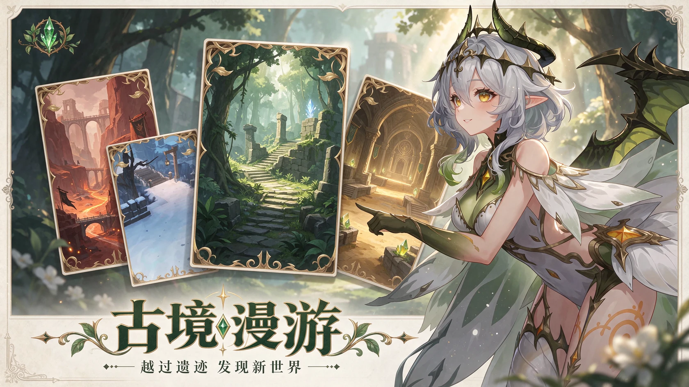
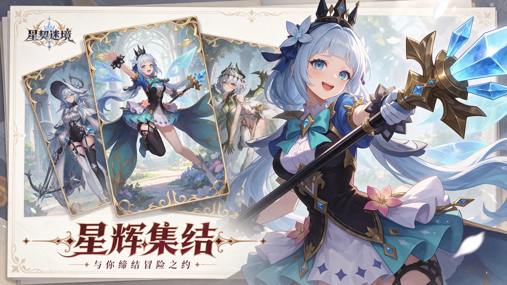
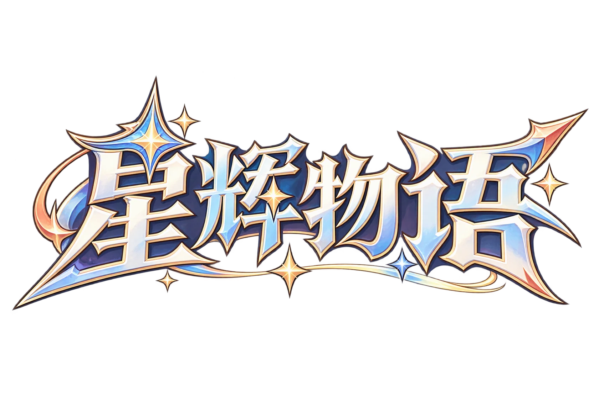

# 游戏美宣设计 · Game Promo Design

面向游戏宣传与运营的 Agent Skill。把角色素材、传播目标和指定文案，变成可执行的视觉方向、版式、素材清单与出图提示词。宿主接有图片工具时，也可接着制作和检查成图。

[安装](#安装) · [怎么用](#怎么用) · [模型](#模型) · [例图](#例图)

## 安装

需要支持 Agent Skills 的助手。安装时请保留整个 `game-promo-design` 文件夹，让助手能读取 [入口](game-promo-design/SKILL.md) 和配套参考。

**Codex · Windows PowerShell**

```powershell
git clone https://github.com/hx143853-sys/game-promo-design-skill.git
$skillRoot = Join-Path $env:USERPROFILE '.agents\skills'
New-Item -ItemType Directory -Path $skillRoot -Force | Out-Null
Copy-Item -LiteralPath '.\game-promo-design-skill\game-promo-design' -Destination $skillRoot -Recurse
```

**Codex · macOS / Linux**

```bash
git clone https://github.com/hx143853-sys/game-promo-design-skill.git
mkdir -p "$HOME/.agents/skills"
cp -R game-promo-design-skill/game-promo-design "$HOME/.agents/skills/"
```

已经安装同名 Skill 时，请先核对现有版本，按需更新同一个目录。只想在当前仓库启用时，将文件夹放在该仓库的 `.agents/skills/` 下。若 Skill 选择器还未显示，重启 Codex 后再看。其他宿主按其 Skill 加载目录放置同一文件夹。[Codex Skills 官方文档](https://developers.openai.com/codex/skills)

## 怎么用

1. 选择 `game-promo-design`，或在请求中写明「使用游戏美宣设计 Skill」。
2. 说清物料放在哪里、面向谁、尺寸或比例，以及画面上的准确文字。上传角色和参考图时，标明哪张用于保留身份、哪张仅参考画风或版式。
3. 查看构图、标题位置、缺失素材和出图提示词。需要制作成图时，使用宿主已接入的图片工具。设计方案和文本提示词也可以复制到你惯用的图片或排版工具执行。
4. 按实际展示尺寸检查主体、标题、按钮和视觉层级。对照输入确认该保留的文本和角色特征。

```text
使用 game-promo-design 做一张 16:9 游戏版本 KV。
附件 1 是角色素材，保留服装、发型和武器。附件 2 只参考构图和明暗。
标题为「幻夜回响 · 炽光重逢」。
请先给出主体站位、标题与留白安排，以及可复制的出图提示词。
```

在 [Guagua](https://guaguacreator.com) 中，首页的「游戏 KV 制作」「游戏运营弹窗」「游戏买量图片」会使用这份设计方法。提供素材与需求后，Guagua 会在项目内组织参考并保存实际结果。公开包可独立提供方案与提示词，平台画布和工具由 Guagua 提供。

## 模型

| 环节 | 选用方式 |
| --- | --- |
| 阅读参考、制定构图、写提示词 | 使用宿主中支持视觉输入的助手模型。只有文字输入时，交付限于文字方案。 |
| 通用图片首稿 | 可用 GPT Image 2.5 Flare。多角色、复杂标题或信息密集版式可选 GPT Image 2.5 Sunburst。宿主已提供 2.6 时，也可按任务选相应档位。 |
| 局部精修 | 初稿确认后，可选 Nano Banana Pro 处理指定问题。先写清要改的部位和需要保留的画面。 |

本批能核对到原件的版本 KV 和弹窗保存为 Seedream 5.5，艺术字与 Logo 由 GPT Image 2.5 Sunburst 制作。上表是可选的模型路线。下面例图逐张按画布成品记录标注，无法确认的写作「未记录」。生图工具、账号和可用档位由宿主管理，API Key 通过你自己的环境配置。

## 例图

### 宣传主视觉

**幻夜回响 · 炽光重逢** · 版本 KV · Seedream 5.5

<a href="examples/version-kv.webp"></a>

多角色围绕发光晶体聚焦，标题压在前景中央。

**与光重逢** · 周年庆典 KV · Seedream 5.5

<a href="examples/version-kv-alt.webp"></a>

角色跟随由左下往右上展开的斜线，留出版头与标题区。

**惊夜奇谭** · 节日活动海报 · 模型未记录

<a href="examples/event-poster.webp"></a>

以月亮、餐桌和南瓜灯构成明确的万圣节场景。

### 运营活动

**盛夏星弦** · 运营弹窗 · Seedream 5.5

<a href="examples/event-popup-a.webp"></a>

角色在左，右侧按标题、奖励与行动按钮组织。

**音浪狂想** · 运营弹窗 · Seedream 5.5

<a href="examples/event-popup-b.webp"></a>

用层级清晰的奖励卡片承接标题和角色。

### 买量创意

**古境漫游** · 买量创意 · 模型未记录

<a href="examples/ad-creative-a.webp"></a>

场景卡片突出冒险地点，让玩家先读到探索卖点。

**星辉集结** · 买量创意 · 模型未记录

<a href="examples/ad-creative-b.webp"></a>

群像卡片与近景角色共同表达伙伴集结。

### 品牌与艺术字

**集结伙伴，奔赴奇幻冒险** · 白紫主标题 · GPT Image 2.5 Sunburst

<a href="examples/type-treatment.webp"></a>

两行错落排布，拉开主次和阅读节奏。

**星辉物语** · 西幻 Logo · GPT Image 2.5 Sunburst

<a href="examples/fantasy-wordmark.webp"></a>

以描边、星形高光和起伏字骨构成独立字标。

## 参考资料

入口中的品类卡覆盖宣传主视觉、运营活动、买量投放、商店与渠道、社媒传播、网页与 H5、游戏内物料、品牌与艺术字、线下物料。按对应版位读取，再按需要使用字组设计、参考图、光影、构图与适配资料。[查看 Skill 和品类卡](game-promo-design/SKILL.md)

例图来自作者指定的作品集素材。例图出处与本包参考资料见 [CREDITS.md](CREDITS.md)。
